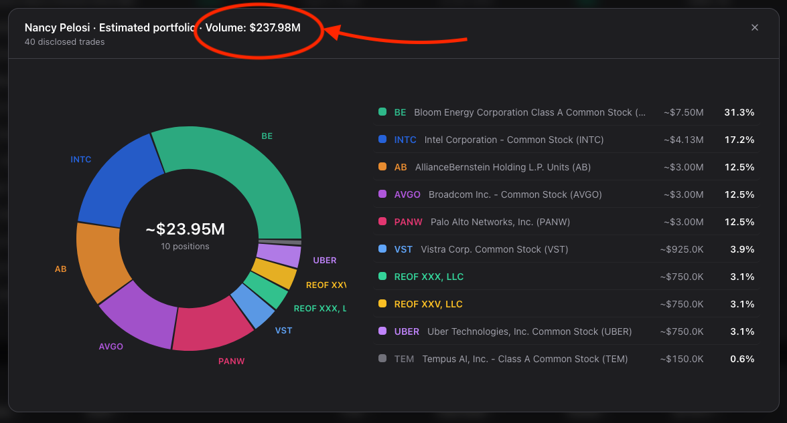
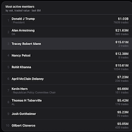

# Trade Volume Feature



Use to your liking. Just a basic mockup of how I would implement this. Many areas can be subject to change, depending on stack and data sourcing.

*Adds the estimated **all time** trade volume to the politician portfolio modal title:*

```
Nancy Pelosi · Estimated portfolio · Volume: $237.98M
```
Volume is calculated by the sum of each disclosed trade's amount. Disclosures report amount in 
**ranges** (e.g. `$500,001 - $1,000,000`), so each trade is counted at the
**midpoint** of its range by default. Low and high variants are also supported.

> [!IMPORTANT]
> The prototype for this feature only read **House** periodic transaction
> reports, so it only covers House members. Senators and executive-branch
> officials (e.g. the President) file through separate systems whose formats
> were not checked. The feature should be built on the site's own trade data,
> which already includes these filers, and the amount handling below should be
> confirmed against their records.

## Coverage

Assumptions to verify per filer type:

- Amounts are reported as a **range** (`amountMin` to `amountMax`). If a filer
  reports an **exact** value, treat it as `min = max`.
- Bracket boundaries may differ between systems. The midpoint math does not
  depend on them, but any validation against known brackets would.
- Where a filer has no usable amounts, show nothing instead of `$0`.


## Sections

| File | Descripton |
| --- | --- |
| `tradeVolume.ts` | Just the math behind calculating volume (`$237.98M`, `$12.5K`). No network or UI. |
| `volumeSource.ts` | Fetches the volume totals for one politician. **Currently a stub** (see below). |
| `PortfolioModalHeader.tsx` | UI change (**Assuming React and Tailwind frontend**): calls the data source and renders `· Volume: $X` inside the existing `<h2>`. |


## Implementation

I did not know how data is sourced, so I've loosely assumed how it would work. You can optionally just used the 6 months data that you have wired up at the bottom of the page. 



1. **Filling in the data source.** Open `volumeSource.ts` and replace the
   `TODO(dev)` stub in `getVolumeSummary(slug)` with a real call. It should
   return:
   ```ts
   { low: number, mid: number, high: number, tradeCount: number }
   ```


- **Suggestion (not required):** computing the total server-side and caching it
  means the client receives one small object instead of the full trade list.
  For example, in SQL this is roughly
  `SUM((amount_min + amount_max) / 2)` grouped by politician (column names are
  illustrative).

2. **Wire up the header.** Make sure `PortfolioModalHeader.tsx` is rendered where
   the modal title currently is. It reuses the heading's existing classes, so the
   volume text inherits the site's font, size, weight, and color.
3. **Test the math.** `tradeVolume()` and `formatUsdCompact()` are pure
   functions, so a few unit tests with fake trades cover them.
    

## Behavior

- If the request fails or returns nothing, the volume text is simply not shown.
- Formatting: `$X.XXM` at 1,000,000 and above, `$X.XK` at 1,000 and above,
  otherwise whole dollars.

> [!IMPORTANT]
> **Top bracket:** "Over $50,000,000" has no upper bound. The prototype counted it at its floor. 
>
> **Chambers:** House and Senate filings come from different systems. Confirm both get the same treatment.

Thank you for taking the time to view this. Hopefully something can be taken from this and applied to improve the UX of the site. 

